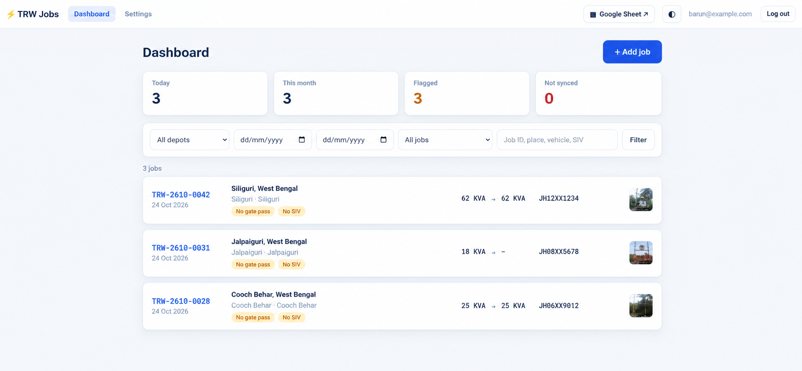
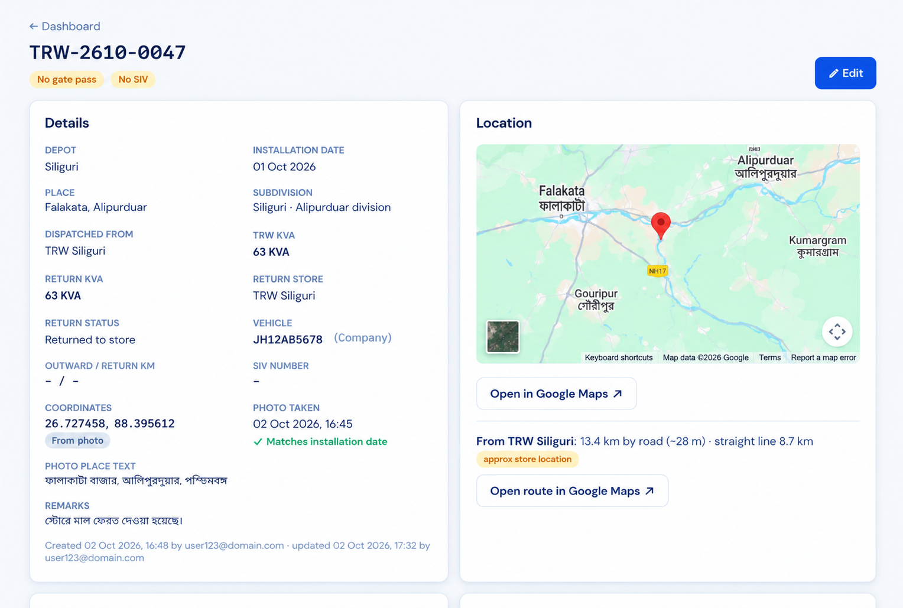
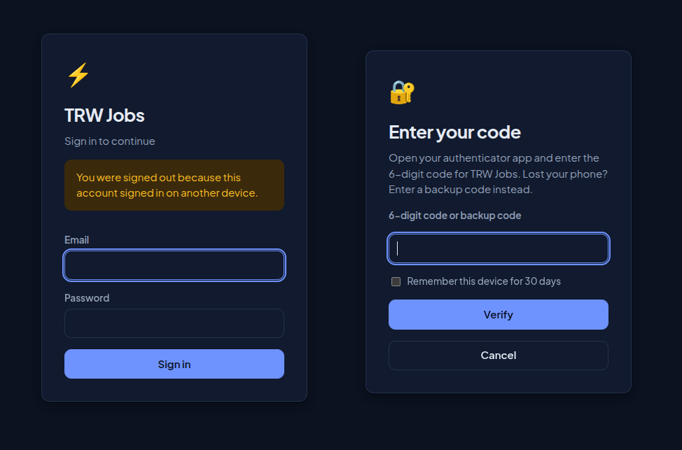

# Barun Ghosh

**Full-stack Product Engineer · AI-assisted delivery · Field ops & business automation**

I turn operations that run on WhatsApp, phone calls and spreadsheets into production software — mobile app, API, dashboard and infrastructure — and then train the people who use it. AI agents do the heavy lifting in parallel; I own the design, review, security and testing.

[LinkedIn](https://linkedin.com/in/barungh) · [Blog](https://hashnode.com/@barungh) · [Email](mailto:iambarun@zohomail.in) · Siliguri, India (IST) · Open to remote roles and contracts

---

## Featured: Ayukshit Ops — field operations platform

A client solution I designed, built and am rolling out end to end. It replaces WhatsApp groups, calls and Excel logs with one system for field jobs, vehicles, fuel and attendance across 6 workshops, 3 central stores and several districts.

> Screenshots use dummy data. Client code is private; this is a showcase.

| Supervisor dashboard | Job review with GPS evidence |
| :---: | :---: |
|  |  |
| **Android field app** | **Owner reports (English / Hindi)** |
|  |  |

<p align="center"><br><sub>Secure sign-in: one active session per login, authenticator-app 2FA with backup codes</sub></p>

**What it does**

- Android app for field staff: attendance, job stages, fuel fills — every photo GPS-stamped
- Role-based dashboard for owners, admin and supervisors; supervisor approval makes work billable
- Gemini vision reads work-order documents and odometer photos; staff confirm or correct
- Anomalies flagged to owners; English and Hindi reports as PDF, Excel and interactive HTML

**How it was delivered**

- Plan frozen to backend + dashboard in production in **12 days**
- Parallel AI-agent workstreams (Claude Code) for backend, Android, dashboard and infra, each change reviewed by me
- Hardened production: Docker on Linode, key-only SSH, fail2ban, Tailscale, 2FA, Backblaze B2 offsite backups with a tested restore, Uptime Kuma alerts

```
 Android app ──┐                         ┌── Owner / admin / supervisor dashboard
               ├──► FastAPI ──► PostgreSQL + PostGIS
 Gemini vision ┘        │         Redis
                        └──► Backblaze B2 backups · Uptime Kuma monitoring
```

`Python` `FastAPI` `PostgreSQL` `PostGIS` `Redis` `Android` `Gemini API` `Docker` `Linode`

---

## How I deliver

1. **Research** — AI-assisted domain research + interviews with owners and field staff
2. **Plan** — written spec: data model, endpoints, decisions log, agent-ready prompts
3. **Build** — parallel AI coding agents; I review and test every change
4. **Deploy** — hardened servers, tested backups, monitoring
5. **Implement & train** — pilot rollout, training in English and Hindi, fast iteration

---

## Other work

| Project | What | Status |
| --- | --- | --- |
| [sikkimkhadi.com](https://sikkimkhadi.com) | Angular site + backend for an institutional client; admin CMS in progress | Live since 2021 |
| CDR Inspector | Call detail record parser: Python → Rust → WebAssembly, runs in the browser | Built |
| GST Billing SaaS | Multi-tenant subscription billing for Indian small businesses (FastAPI, PostgreSQL) | In development |
| Stock research platform | Research tool for Indian retail traders | In development |

---

## Stack

**AI:** Claude Code · Gemini API · Google AI Studio · pgvector
**Backend:** Python · FastAPI · Django · Pydantic · SQLAlchemy
**Data:** PostgreSQL · PostGIS · Redis · SQLite
**Frontend / mobile:** Angular · TypeScript · Android
**Infra:** Docker · Nginx · Linux · Linode · Oracle Cloud · Tailscale · Backblaze B2
**Systems:** Rust · WebAssembly · Bash

---

I also run [Purvika Institute of Learning](https://purvika.vercel.app/), where I teach Python, databases and backend development — the same skill I use to train client teams on the systems I build.
